# Hướng dẫn bằng hình: gán nhãn một ảnh front trên CVAT

Tài liệu đi từng bước, từ lúc đăng nhập tới lúc export, theo [Guideline Road v1.0](guideline_road_v1.0.md). Ảnh chụp từ CVAT v2.82.0 ngày 17/11/2026.

> **Ảnh minh hoạ là ảnh tổng hợp**, do script vẽ ra (góc dưới có dòng chữ `SYNTHETIC … - not a dataset image`). Nó không phải ảnh lớp học và không lấy pixel từ bộ dữ liệu nào. Ảnh lớp trông khác, nhưng các thao tác thì y hệt. Tên tài khoản trên thanh trên cùng đã được che.

Ảnh demo có ba vạch: L1 trắng đứt, R1 trắng liền, L2 vàng. Thứ tự làm: tag → lane → drivable → Save → Finish → Export → lint.

## 1. Đăng nhập, mở project và task

Mở địa chỉ CVAT lớp rồi đăng nhập bằng tài khoản được cấp.

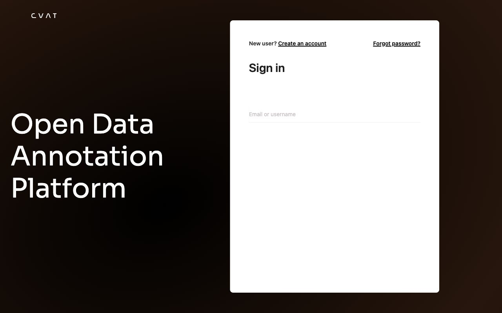

Vào **Projects**, mở project `d11-road-<tên>`. Kiểm tra project có đủ 6 label vẽ và 4 label tag (checkpoint Task 0). Bấm **Open** ở task `front` để mở job.

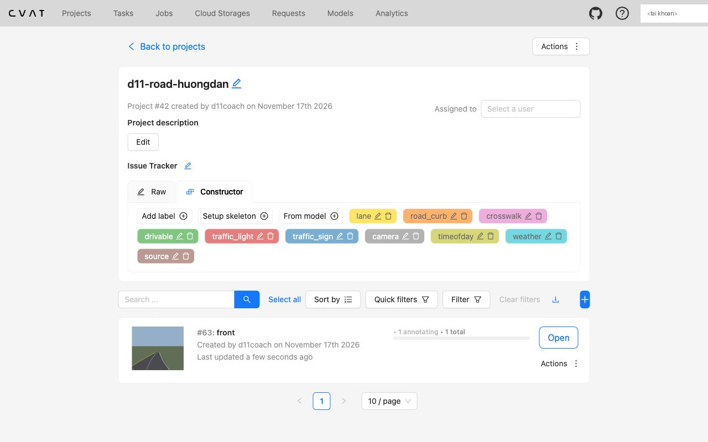

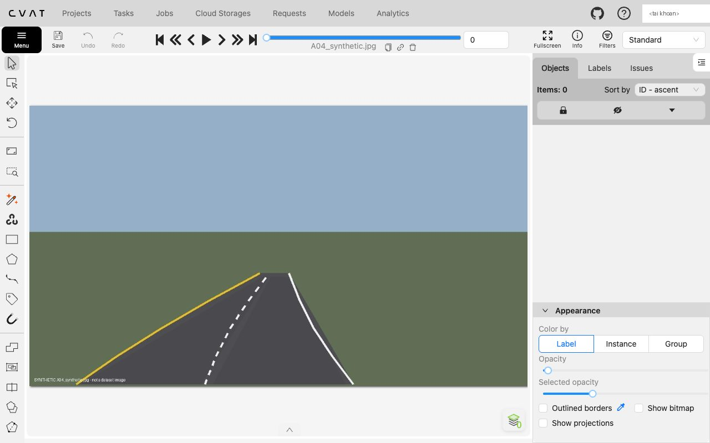

## 2. Đặt 4 tag, tag camera trước tiên

Dùng công cụ Tag ở thanh bên trái. Đặt **camera** trước, sau đó **timeofday**, **weather**, **source**. Trong bảng Objects, mở **Details** của từng tag để kiểm giá trị.

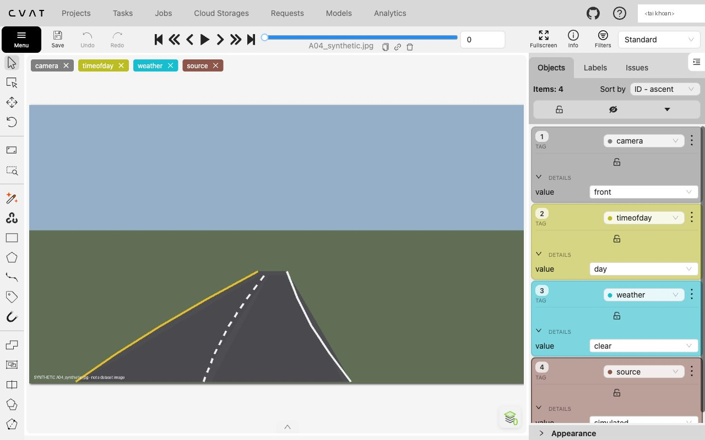

- Ảnh demo mang `camera=front`, `timeofday=day`, `weather=clear`, `source=simulated`, vì nó là ảnh tổng hợp. Với ảnh lớp, chọn `source` đúng theo nguồn gốc của ảnh đó.
- CVAT tự điền giá trị đầu tiên của danh sách, ví dụ `weather=clear`. Lint không bắt được tag sai nếu giá trị đó vẫn hợp lệ, nên phải tự kiểm từng tag.

## 3. Vẽ lane bằng Polyline, từ gần ra xa

Chọn công cụ **Polyline**, label `lane`, rồi bấm **Shape**.

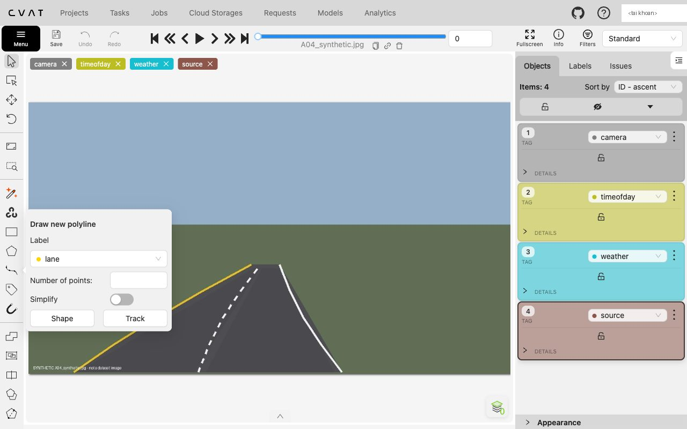

Click lần lượt các điểm trên tâm vệt sơn. Bắt đầu từ phía gần xe (đáy ảnh) và đi ra xa, xong thì bấm phím **N** để kết thúc.

Lane vừa vẽ sẽ tự mang giá trị **mặc định** `L1 / solid / white / single`. Đó chưa phải giá trị bạn đã kiểm.

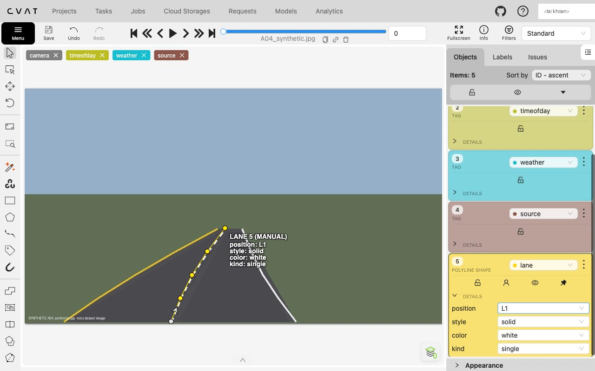

## 4. Sửa thuộc tính lane trong Details

Mở **Details** của lane trong bảng Objects, rồi chỉnh `position`, `style`, `color`, `kind` cho khớp với ảnh.

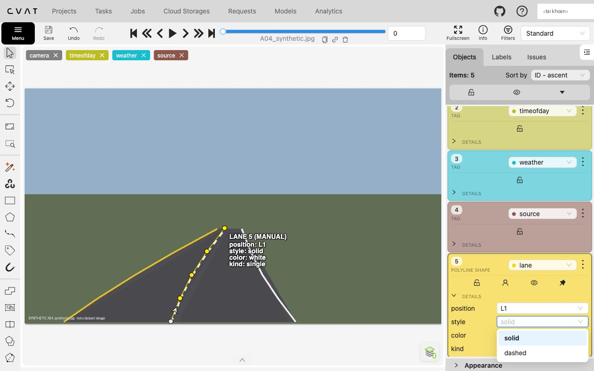

Vạch trắng đứt sát bên trái làn mình đi là **L1 · dashed · white · single**.

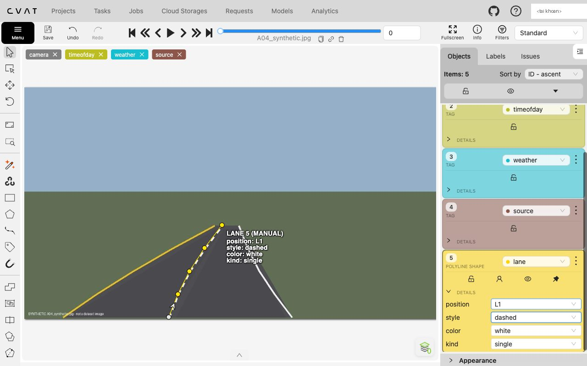

Các vạch còn lại vẽ theo cách tương tự. Ví dụ dưới đây là vạch vàng bên trái L1, gán **L2 · solid · yellow · double**. Trong ảnh tổng hợp, vạch đôi chỉ được vẽ thành một nét. Ở ảnh thật, hai nét song song thì chọn `kind=double`.

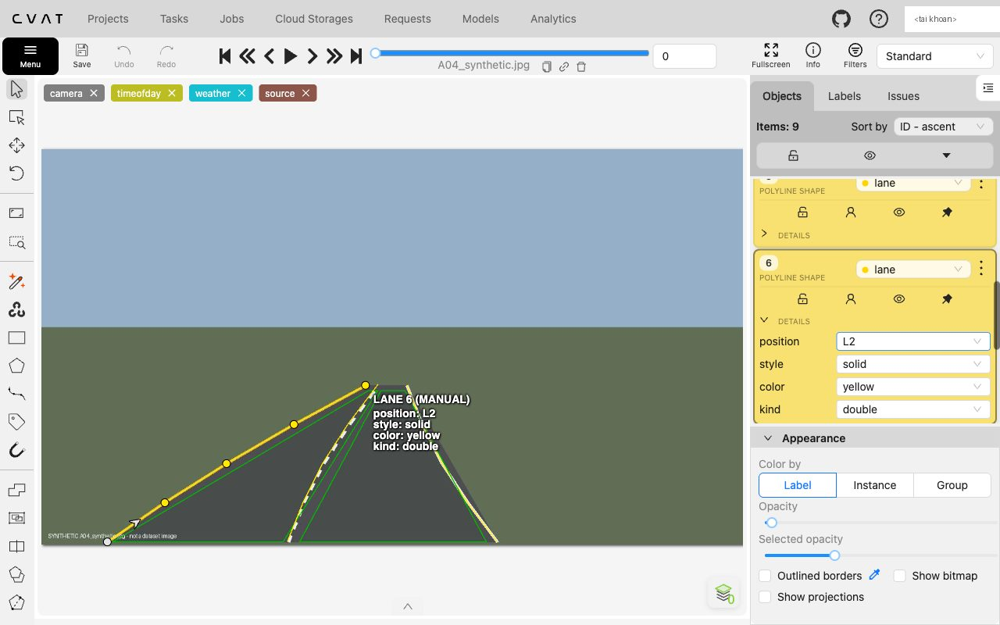

Mép đường không có vạch sơn thì vẽ polyline label `road_curb`, cũng đi từ gần ra xa. Ảnh demo không có lề như vậy nên không có bước này.

## 5. drivable: một polygon direct và một polygon alternative

Chọn công cụ **Polygon**, label `drivable`.

- `area_type = direct`: làn mình đang đi. Cắt polygon ở mép capô xe nếu capô lọt vào ảnh.

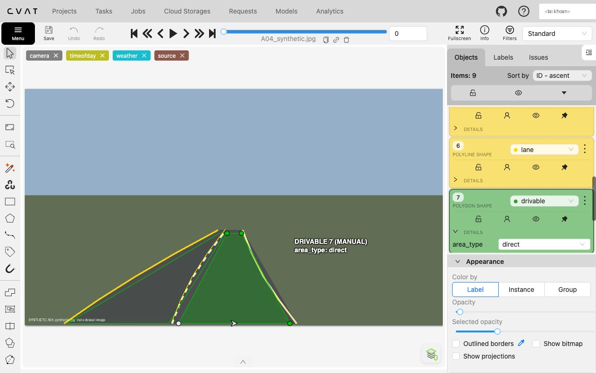

- Polygon thứ hai cho làn bên cạnh. Đổi `area_type` thành **alternative**, vì giá trị mặc định là direct.

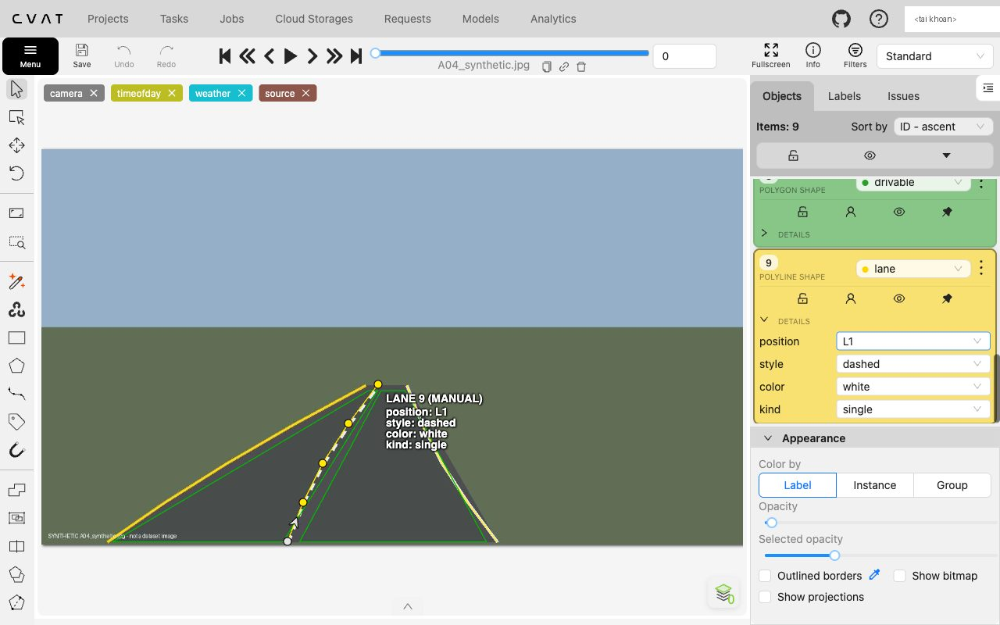

## 6. Không vẽ vạch mà ảnh không có

Nếu một bên làn không có vạch sơn, chẳng hạn chỉ có lề hoặc hàng xe đỗ, thì **không vẽ** L1 hay R1 cho bên đó. Lint sẽ báo QC1-02 "chưa có L1/R1". Khi đó, gọi coach nhìn ảnh để xác nhận, rồi ghi mã ảnh và lý do vào phiếu QC 1. Ca này được miễn theo [CHECKPOINTS](../CHECKPOINTS.md).

## 7. Save, rồi Finish the job

Bấm **Save** ở thanh trên cùng. Sau đó mở **Menu** (góc trên bên trái).

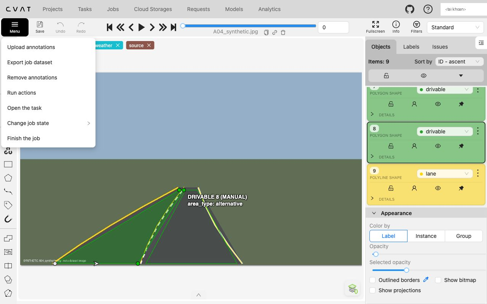

Chọn **Finish the job**, rồi bấm **Continue**. Lệnh này lưu nhãn và chuyển job sang trạng thái completed.

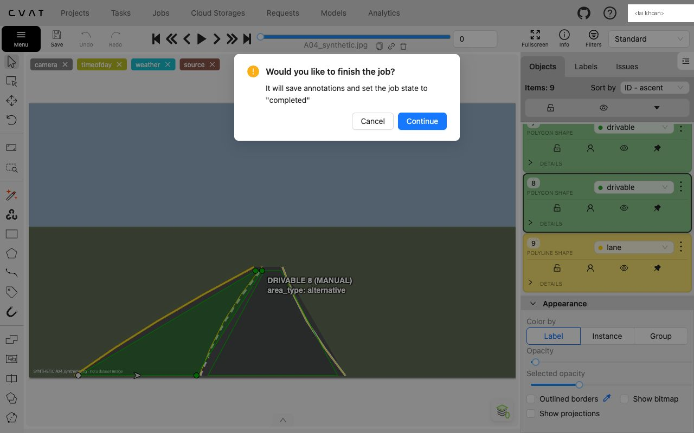

Quay lại trang task để kiểm: cột **State** của job phải là `completed`.

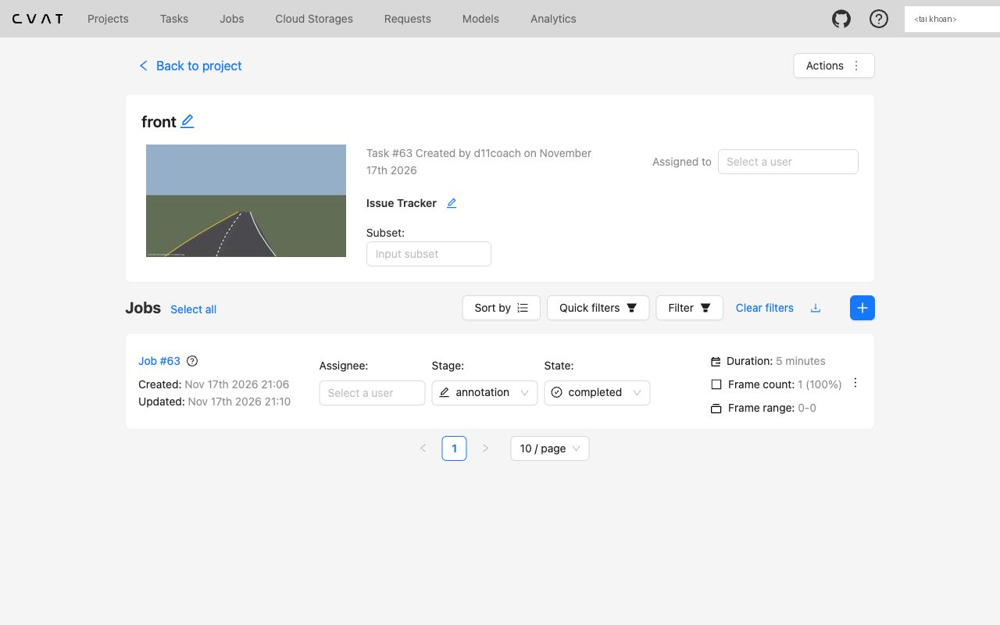

## 8. Export CVAT for images 1.1, không kèm ảnh

Mở **Menu → Export job dataset** và điền như sau:

- Format: **CVAT for images 1.1** (không phải COCO).
- **Save images**: tắt.
- Custom name: `<tên>-front`.

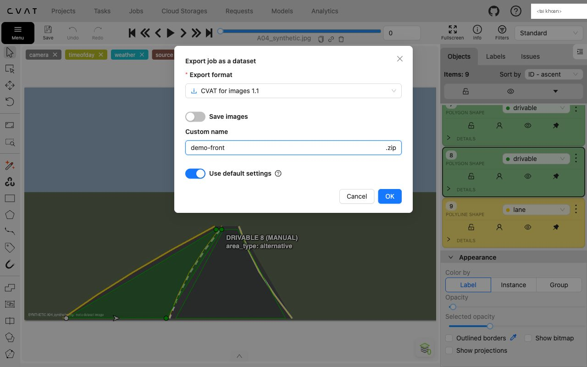

Bấm OK, rồi tải file zip ở trang **Requests**. Làm tương tự với task fisheye để có `<tên>-fisheye.zip`. Sau đó chạy lint và tạo manifest:

```bash
PYTHONPATH=src python3 -m road_lab.road_check lint <tên>-front.zip <tên>-fisheye.zip --manifest <tên>-manifest.json --name <tên> --revision 1
```

Mở manifest và kiểm tra `contains_images` là `false`. Định dạng nộp đầy đủ xem ở [Đặc tả bàn giao](delivery_road_v1.0.md).
